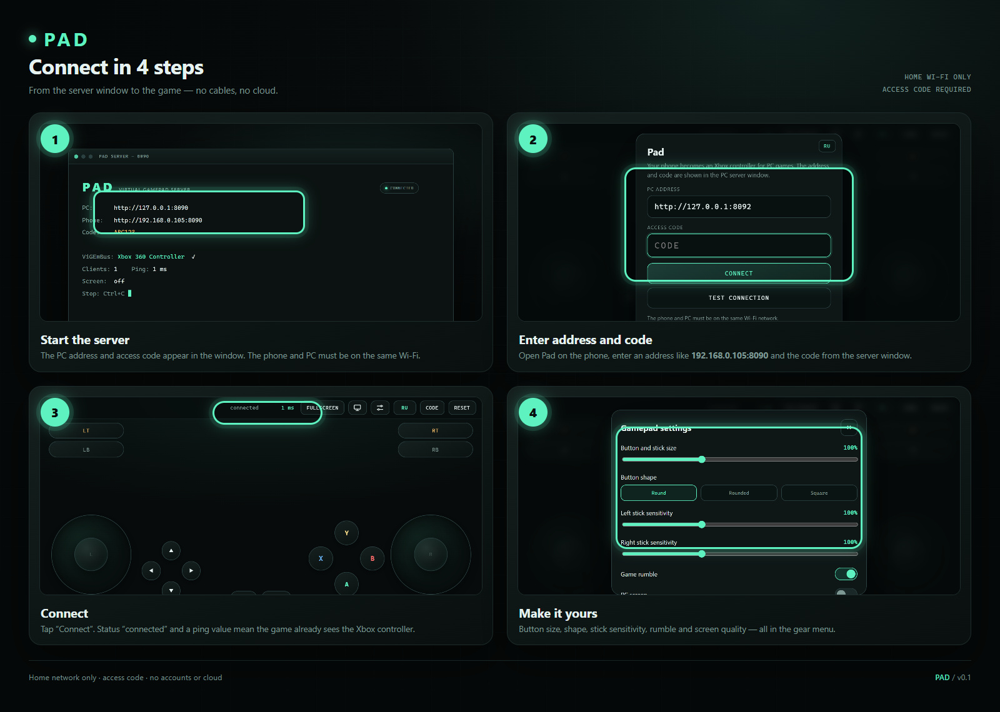
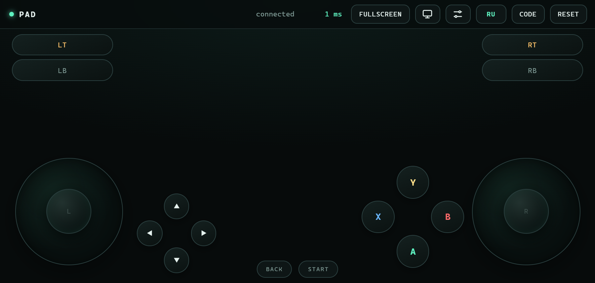
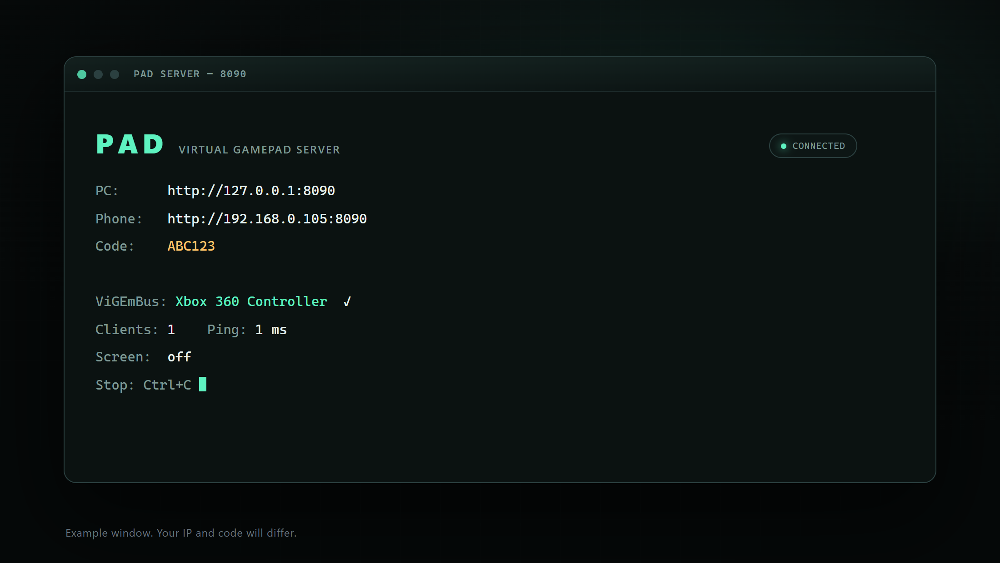

# Pad

**Turn your phone into a gamepad for your PC.** Pad is a standalone project: a small Windows server plus an Android app/web page. No accounts, subscriptions, cloud or AI — everything stays on your home Wi-Fi.

UI: RU/EN — switch in the header and on the connection screen.

[Русская версия →](README.ru.md)



## What it is

Pad turns a phone into a virtual **Xbox 360** controller. A small server on the PC creates a system gamepad through ViGEmBus. The phone sends stick positions and button presses over WebSocket, and the game sees a regular Xbox controller.

- PC: Windows 10/11
- Phone: Android (APK) or any browser on the same Wi-Fi
- No cables needed after setup

## Features

- Two analog sticks, ABXY, D-pad, LB/RB, LT/RT, Back/Start, stick clicks.
- Game rumble passed to the phone.
- Button size, shape and position editor.
- Separate sensitivity for the left and right sticks.
- Immersive mode: the PC screen as a background under the controls.
- Screen quality/FPS options: 640/960/1280/1600 px, 15/30/60/120 fps.
- Fullscreen, keep-screen-on, landscape layout.
- Access code and local-network-only operation.

## Screenshots

| Phone | PC server |
| --- | --- |
|  |  |

Settings: [settings.en.png](docs/mockups/settings.en.png)

> These are UI mockups: the IP address and code are examples, not real.

## How to connect

### 1. Prepare the PC

1. Install the **ViGEmBus** driver (required for the virtual Xbox controller).
2. Start `PadServer.exe` (or `py server.py` from source).
3. The server window shows the address and access code:
   ```
   PC:      http://127.0.0.1:8090
   Phone:   http://192.168.0.105:8090
   Code:    ABC123
   ```
4. If Windows asks about the network, allow **Private**. You can also run `add-firewall-rule.bat` once.

### 2. Connect the phone

1. Install the APK on Android.
2. Connect the phone to the same Wi-Fi as the PC.
3. Open Pad and enter:
   - **PC address**: `192.168.0.105:8090` (from the server window);
   - **Access code**: the code shown by the server.
4. Tap **Check connection**, then **Connect**.
5. When the status says `connected`, the game should see a new Xbox controller.

> If the phone cannot find the PC: make sure both devices are on the same network, the firewall allows the server, and the address is copied from the server window.
>
> If the PC answers `http://127.0.0.1:8090` with an immediate refusal while the phone just keeps waiting, the server is not running. Close the server window and start `PadServer.exe` again.

### Browser instead of the APK

You can open `http://<PC-IP>:8090` on the phone — the interface is the same. The APK is more convenient: it keeps the screen on and runs fullscreen.

## PC screen

The monitor button in the top bar streams the PC screen behind the controls. The stream runs only while the view is open. Choose quality/FPS in settings; on a weak Wi-Fi start with 960 px / 30 fps.

## Development

### Server

```bash
py -3 -m pip install -r server/requirements.txt
py server/server.py --port 8090
```

`code.txt` with the access code is created automatically next to the server. Do not commit it.

Build the exe:

```bash
cd server
py -3 -m PyInstaller PadServer.spec
```

Result: `server/dist/PadServer.exe`.

### Android/APK

Requires Rust, Tauri 2, JDK 17, Android SDK/NDK and Rust Android targets.

```bash
cd mobile
cargo tauri android init   # once, creates gen/android
build-apk.bat
```

`build-apk.bat` tries to call `android-env.bat` one level above if present; otherwise set `ANDROID_HOME`, `NDK_HOME`, `JAVA_HOME` manually.

APK output: `mobile/src-tauri/gen/android/app/build/outputs/apk/...`.

### Web UI

`server/index.html` is a plain page with no build step. The server serves it at `/`.

## Structure

```
Pad/
├─ server/                 # Python server, web UI, exe build
│  ├─ server.py
│  ├─ index.html
│  ├─ requirements.txt
│  ├─ PadServer.spec
│  ├─ start-server.bat
│  └─ add-firewall-rule.bat
├─ mobile/                 # Tauri Android shell
│  ├─ web-pad/index.html
│  ├─ src-tauri/
│  └─ build-apk.bat
├─ release/                # local builds (not in git)
├─ docs/
│  ├─ connection.ru.png
│  ├─ connection.en.png
│  └─ mockups/
├─ README.md
├─ README.en.md
├─ CHANGELOG.md
└─ .gitignore
```

## Updates

- Versions follow SemVer: `0.1.0`, `0.2.0`, `1.0.0`.
- Each release gets a `vX.Y.Z` tag and an entry in [CHANGELOG.md](CHANGELOG.md).
- GitHub Releases will contain ready-to-install `PadServer.exe` and `Pad-debug.apk`; source stays in the repository.
- Binaries are not stored in git (they are large and reproducible from source).
- Auto-update is not part of 0.1.0; it can be added later.

The `release/` folder contains local builds: `PadServer.exe` and `Pad-debug.apk` (debug-signed, package `com.jeny45ton.pad`).

## Security

- The server listens on the local network and requires an access code.
- Do not expose port 8090 to the internet and do not port-forward it on the router.
- The access code lives in `code.txt` next to the server; this file is not committed.
- The firewall rule is private-network only.

## Status

Version **0.1.0** — a working prototype. Source lives in the `Jeny999/pad` repository; the connection was verified on a local network: the phone connects with the access code, sticks, buttons and rumble work.

No builds are stored in git: `PadServer.exe` and `Pad-debug.apk` are built from source or taken from the local `release/` folder.

## License

License not chosen yet (TBD). Until a license is added, all rights are reserved by the author.
