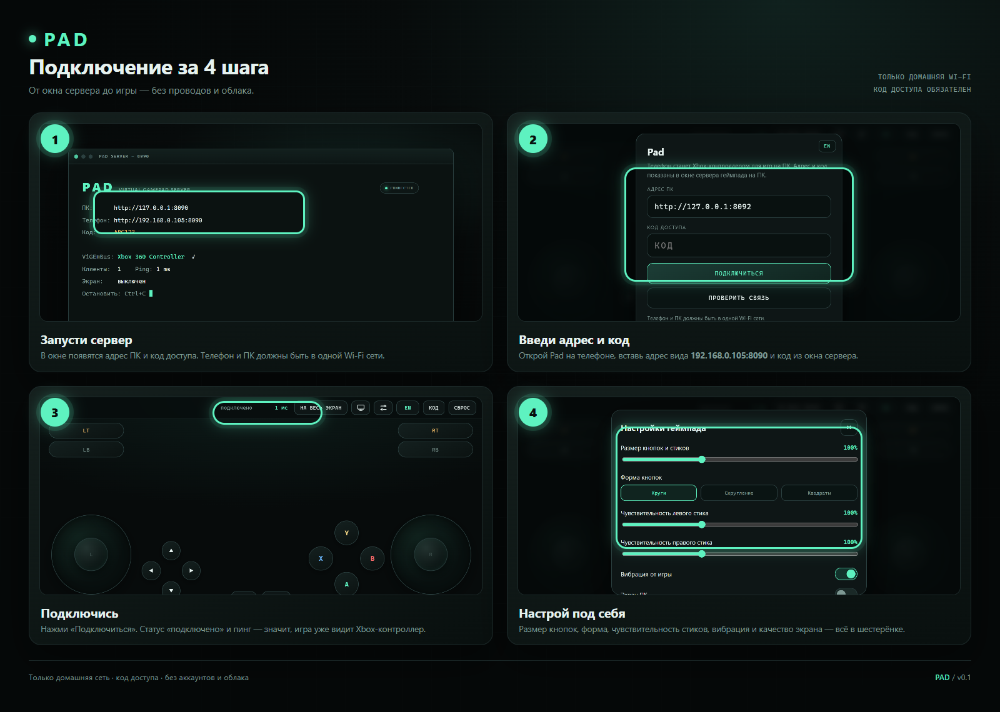
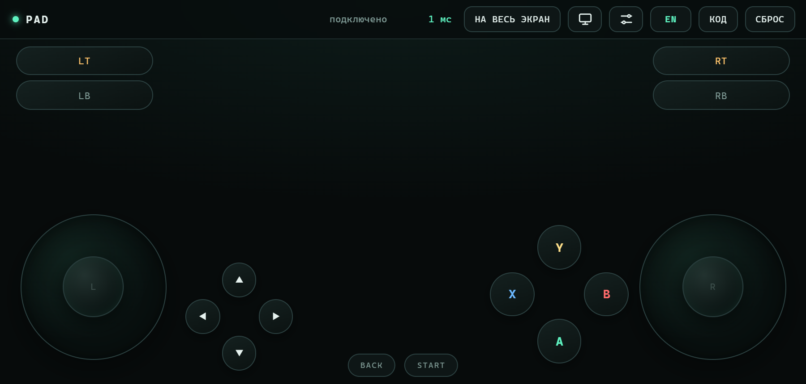
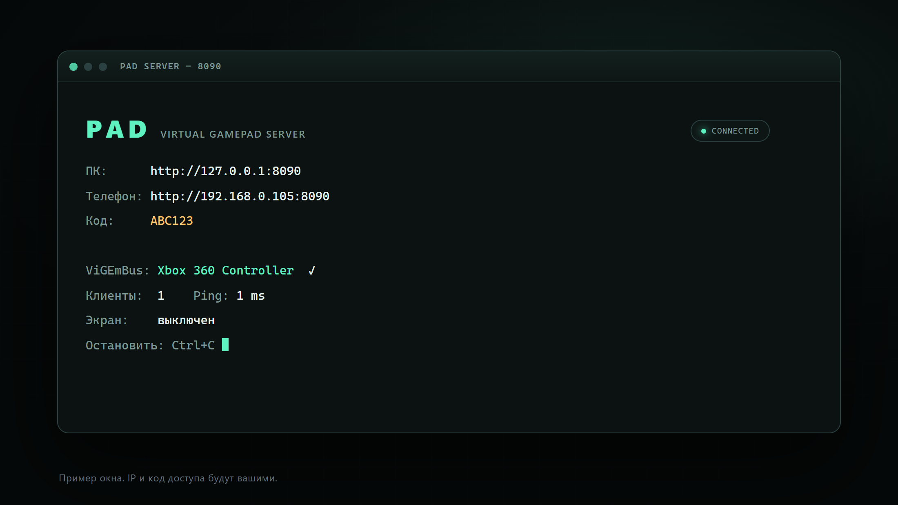

# Pad

**Телефон как геймпад для ПК.** Отдельный проект: сервер на Windows и приложение/веб-страница на телефоне. Без аккаунтов, подписок, облака и ИИ — всё работает в домашней Wi-Fi сети.

Интерфейс: RU/EN — переключатель в шапке и на экране подключения.

[English version →](README.en.md)



## Что это

Pad превращает телефон в виртуальный **Xbox 360** контроллер. На ПК запускается маленький сервер, который через ViGEmBus создаёт системный геймпад. Телефон отправляет положение стиков и нажатия кнопок по WebSocket, а игра видит обычный Xbox-контроллер.

- ПК: Windows 10/11
- Телефон: Android (APK) или любой браузер в той же Wi-Fi сети
- Никаких проводов после установки

## Возможности

- Два аналоговых стика, ABXY, D-pad, LB/RB, LT/RT, Back/Start, нажатия стиков.
- Вибрация от игры (rumble) на телефоне.
- Настройка размера, формы и расположения кнопок.
- Раздельная чувствительность левого и правого стиков.
- Прозрачный режим: экран ПК как фон под кнопками.
- Качество и FPS трансляции экрана: 640/960/1280/1600 px, 15/30/60/120 fps.
- Полный экран, удержание экрана включённым, ландшафтная ориентация.
- Код доступа к серверу и работа только в локальной сети.

## Скриншоты

| Телефон | ПК-сервер |
| --- | --- |
|  |  |

Настройки: [settings.ru.png](docs/mockups/settings.ru.png)

> Это мокапы интерфейса: IP-адрес и код в примерах — не настоящие.

## Как подключить

### 1. Подготовьте ПК

1. Установите драйвер **ViGEmBus** (нужен для виртуального Xbox-контроллера).
2. Запустите `PadServer.exe` (или `py server.py` из исходников).
3. В окне сервера будут адрес и код доступа:
   ```
   ПК:      http://127.0.0.1:8090
   Телефон: http://192.168.0.105:8090
   Код:     ABC123
   ```
4. Если Windows спросит про сеть — разрешите доступ для **частной** сети. Можно один раз запустить `add-firewall-rule.bat`.

### 2. Подключите телефон

1. Установите APK на Android.
2. Подключите телефон к той же Wi-Fi сети, что и ПК.
3. Откройте Pad и введите:
   - **Адрес ПК**: `192.168.0.105:8090` (из окна сервера);
   - **Код доступа**: код из окна сервера.
4. Нажмите **«Проверить связь»**, затем **«Подключиться»**.
5. Если всё верно, вверху появится `подключено`, а в игре — новый Xbox-контроллер.

> Если телефон не видит ПК: проверьте, что оба устройства в одной сети, сервер не заблокирован firewall, а адрес взят именно из окна сервера.
>
> Если на ПК `http://127.0.0.1:8090` сразу отвечает отказом, а телефон долго «думает» — сервер не запущен. Закройте окно сервера и запустите `PadServer.exe` заново.

### Браузер вместо APK

Можно открыть на телефоне `http://<IP-ПК>:8090` — интерфейс тот же. APK удобнее: он держит экран включённым и работает в полном экране.

## Экран ПК

Кнопка с монитором в верхней панели включает трансляцию экрана ПК на фон геймпада. Поток идёт только пока включён просмотр. Качество и FPS выбираются в настройках; на слабом Wi-Fi лучше начать с 960 px / 30 fps.

## Разработка

### Сервер

```bash
py -3 -m pip install -r server/requirements.txt
py server/server.py --port 8090
```

`code.txt` с кодом доступа создаётся автоматически рядом с сервером. Не коммитьте его.

Сборка exe:

```bash
cd server
py -3 -m PyInstaller PadServer.spec
```

Результат: `server/dist/PadServer.exe`.

### Android/APK

Нужны Rust, Tauri 2, JDK 17, Android SDK/NDK и Android-таргеты Rust.

```bash
cd mobile
cargo tauri android init   # один раз, создаёт gen/android
build-apk.bat
```

`build-apk.bat` попробует вызвать `android-env.bat` на уровень выше, если он есть; иначе настройте `ANDROID_HOME`, `NDK_HOME`, `JAVA_HOME` вручную.

Готовый APK: `mobile/src-tauri/gen/android/app/build/outputs/apk/...`.

### Веб-интерфейс

`server/index.html` — обычная страница без сборки. Сервер отдаёт её на `/`.

## Структура

```
Pad/
├─ server/                 # Python-сервер, web-интерфейс, сборка exe
│  ├─ server.py
│  ├─ index.html
│  ├─ requirements.txt
│  ├─ PadServer.spec
│  ├─ start-server.bat
│  └─ add-firewall-rule.bat
├─ mobile/                 # Tauri-оболочка для Android
│  ├─ web-pad/index.html
│  ├─ src-tauri/
│  └─ build-apk.bat
├─ release/                # локальные сборки (не в git)
├─ docs/
│  ├─ connection.ru.png
│  ├─ connection.en.png
│  └─ mockups/
├─ README.md
├─ README.en.md
├─ CHANGELOG.md
└─ .gitignore
```

## Обновления

- Версии — по SemVer: `0.1.0`, `0.2.0`, `1.0.0`.
- Каждый релиз — тег `vX.Y.Z` и запись в [CHANGELOG.md](CHANGELOG.md).
- В GitHub Releases будут лежать готовые `PadServer.exe` и `Pad-debug.apk`; исходники — в репозитории.
- Бинарники не хранятся в git (они большие и пересобираются из исходников).
- Автообновление пока не входит в 0.1.0; его можно добавить отдельным этапом.

В папке `release/` лежат готовые локальные сборки: `PadServer.exe` и `Pad-debug.apk` (debug-подпись, package `com.jeny45ton.pad`).

## Безопасность

- Сервер слушает локальную сеть и требует код доступа.
- Не открывайте порт 8090 в интернет и не делайте port-forward на роутере.
- Код доступа хранится в `code.txt` рядом с сервером; этот файл не коммитится.
- Firewall-правило — только для частной сети.

## Статус

Версия **0.1.0** — рабочий прототип. Исходники лежат в репозитории `Jeny999/pad`; подключение проверено в локальной сети: телефон подключается по коду, стики, кнопки и вибрация работают.

Готовых сборок в git нет: `PadServer.exe` и `Pad-debug.apk` собираются по инструкции выше или берутся из локальной папки `release/`.

## Лицензия

Лицензия пока не выбрана (TBD). До её добавления все права сохраняются за автором.
